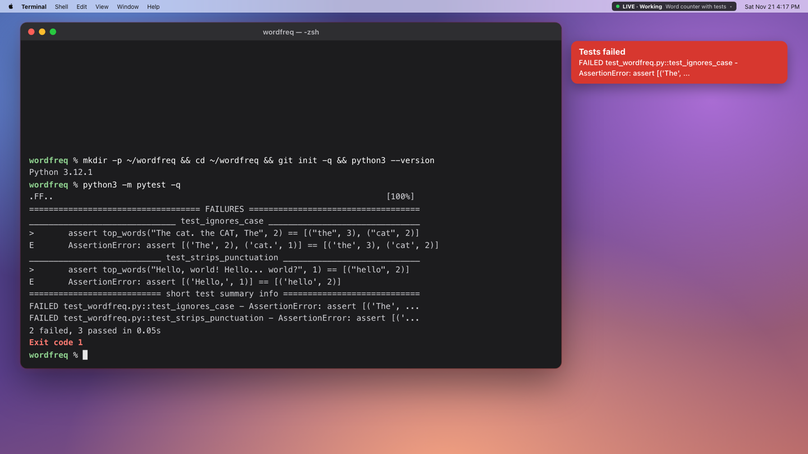

# agentwatch

I got bored of reading logs every time I had to monitor my agents and i wanted to watch my agents work thru a video instead



agentwatch opens a browser window that looks like your agent's computer. Commands type into a terminal, searches open in a browser, edits land in an editor. When something goes wrong, like failing tests or a search that finds nothing, a note pops up.

It works with Claude Code and Codex. It reads the logs they already keep on your machine, so it uses no tokens and sends nothing anywhere.

## Install

Needs Python 3.8+ and curl, on macOS or Linux.

```sh
git clone https://github.com/Yashtik/agentwatch
agentwatch/bin/agentwatch
```

To start it with just `agentwatch` from any folder, link `bin/agentwatch` into a folder on your PATH, like `~/.local/bin`.

## Use

It follows whichever window is working, and the menu at the top right switches between windows. With both Claude Code and Codex open, a switch next to it flips between them. It only shows what happens while it's open. Close the tab to stop it. It also stops when you close your last agent window.

To try it without an agent, run this in the repo folder: `python3 -I live/server.py --fixture fixtures/demo --speed 2` (or `fixtures/demo-codex`)

## More

- How it keeps your sessions private: [SECURITY.md](SECURITY.md)
- Tests: `python3 -I live/test_parse.py`, `python3 -I live/test_server.py`, `python3 live/check_player.py` (needs Playwright)
- License: [MIT](LICENSE)
